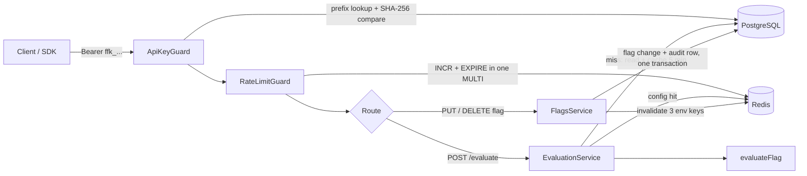
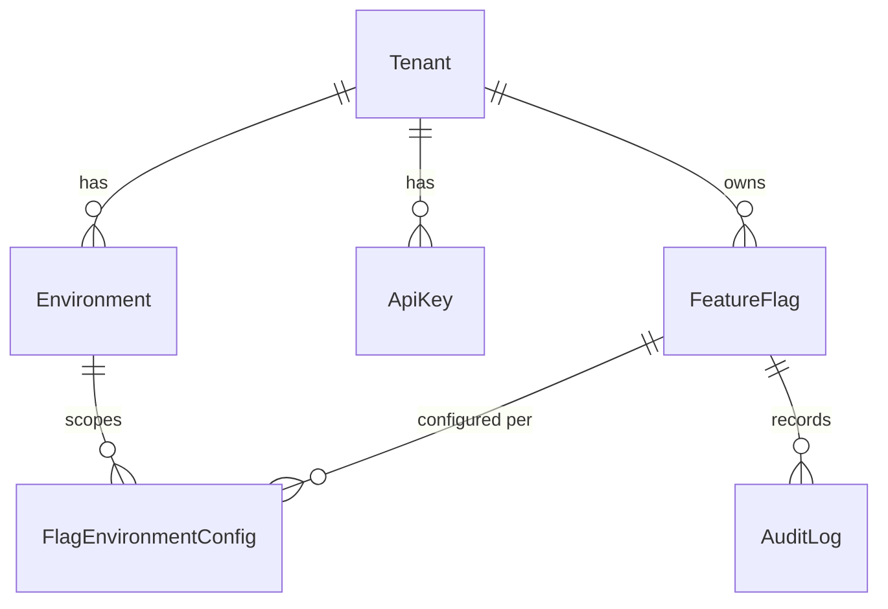

# Multi-Tenant Feature Flag Service

A feature flag and runtime configuration API for multiple tenants, built with
NestJS, PostgreSQL (Prisma) and Redis. Each tenant registers once and gets an
API key plus `development`, `staging` and `production` environments. Flags are
defined once per tenant and configured per environment: on/off, percentage
rollout, attribute targeting, and an optional variant value. Every change is
written to an append-only audit log in the same transaction.

It was written as a backend take-home (Option C, feature flags). The focus is
the evaluation engine, tenant isolation and operability, not a UI.

## Quick start

Requires Docker with Compose.

```bash
docker compose up --build
```

This builds the API image, starts PostgreSQL 17 and Redis 8, applies the Prisma
migrations on container start and serves the API on `http://localhost:3000`.

```bash
curl http://localhost:3000/health/ready
# {"status":"ok","checks":{"database":"up","redis":"up"}}
```

Host ports can be changed with `API_PORT`, `POSTGRES_PORT` (default 55432) and
`REDIS_PORT` (default 56379). Stop and wipe the data with
`docker compose down -v`.

### Running the API on the host

Node 22 is pinned in `.nvmrc` and `engines`.

```bash
nvm use
cp .env.example .env
docker compose up -d postgres redis
npm ci
npx prisma generate
npx prisma migrate deploy
npm run start:dev
```

| Variable | Default | Purpose |
|----------|---------|---------|
| `DATABASE_URL` | compose Postgres on 55432 | Prisma connection string |
| `REDIS_URL` | compose Redis on 56379 | Config cache and rate-limit counters |
| `PORT` | `3000` | HTTP port |
| `LOG_LEVEL` | `info` | pino log level |
| `RATE_LIMIT_PER_MINUTE` | `300` | Requests per tenant per fixed one-minute window |

## How a request flows



- **Authentication.** Keys look like `ffk_<8-char prefix>_<secret>`. Only the
  SHA-256 hash and the prefix are stored; the guard looks up candidates by
  prefix and compares hashes in constant time. A key only grants access to its
  own tenant: a mismatched `tenantId` in the path or `tenant_id` in the body
  returns 403.
- **Rate limiting.** A fixed one-minute window per tenant, one Redis round trip
  per request. Over the limit returns 429 with `Retry-After`.
- **Caching.** Single-flag evaluation caches the flag's environment config in
  Redis for 5 minutes. Updates and archives delete the keys for all three
  environments after the transaction commits. Bulk evaluation reads PostgreSQL
  directly, and evaluation results themselves are never cached.

## Evaluation rules

```
bucket = parseInt(sha256("<flag_key>:<user_id>").slice(0, 8), 16) % 100
in rollout  <=>  bucket < rolloutPercentage
```

The same user always lands in the same bucket for a given flag. Raising the
percentage only adds users, and including the flag key keeps rollouts of
different flags independent.

Rules are checked in this order, and the first match wins:

| Condition | Value served | `reason` |
|-----------|--------------|----------|
| Flag is archived | default value | `archived` |
| Disabled in the environment | default value | `disabled` |
| A targeting rule matches the context | on-value | `targeting_match` |
| User's bucket is inside the rollout | on-value | `rollout` |
| Otherwise | default value | `not_in_rollout` |

The on-value is `variantValue` when set; otherwise `true` for boolean flags and
the default value for string and number flags. A targeting rule
(`{"attribute": "plan", "values": ["enterprise"]}`) matches when the context
attribute equals one of the listed values. Numbers and booleans in the context
are compared by their string form, so `{"plan_tier": 3}` matches `"3"`.

## API

Base path `/api/v1`. Everything except tenant registration needs
`Authorization: Bearer <apiKey>`. Health and metrics sit outside the prefix.

| Method | Path | Purpose |
|--------|------|---------|
| POST | `/tenants` | Register a tenant; returns the API key once |
| POST | `/tenants/:tenantId/flags` | Create a flag (`key`, `type`, `defaultValue`, optional `description`) |
| GET | `/tenants/:tenantId/flags` | List flags; filter with `?environment=` and `?status=active\|archived` |
| PUT | `/tenants/:tenantId/flags/:key` | Update; `enabled`, `rolloutPercentage`, `targetingRules`, `variantValue` need `environment` |
| DELETE | `/tenants/:tenantId/flags/:key` | Archive (soft delete) |
| GET | `/tenants/:tenantId/flags/:key/history` | Audit log, newest first |
| POST | `/evaluate` | Evaluate one flag for a user |
| POST | `/evaluate/bulk` | Evaluate every active flag for a user |
| GET | `/health/live`, `/health/ready` | Liveness; readiness checks PostgreSQL and Redis |
| GET | `/metrics` | Prometheus metrics |

Flag types are `boolean`, `string` and `number`, and every value written to a
flag is checked against its type. Each response carries an `x-correlation-id`
header, echoed from the request when one is supplied.

### Examples

These were captured from `docker compose up` on a fresh database. IDs and
timestamps will differ, and the key's secret part is shortened here.

Register a tenant:

```http
POST /api/v1/tenants
{"name": "Acme Storefront"}
```

```json
{
  "tenant": {
    "id": "671bacb6-c92a-4918-8e6d-99c2c578f84c",
    "name": "Acme Storefront",
    "slug": "acme-storefront",
    "createdAt": "2026-11-08T00:52:33.390Z",
    "environments": [
      { "id": "8c76f74e-88d1-4334-b43a-0d63d94ba78f", "name": "development" },
      { "id": "9d6df6f9-a82f-4165-a48f-1525a04401bb", "name": "staging" },
      { "id": "b96cd6b5-6f3b-445b-a9ee-7a6d6c5d05a6", "name": "production" }
    ]
  },
  "apiKey": "ffk_rXLlmm9l_<secret>"
}
```

Create a flag, then enable it in production for 25% of users plus every
enterprise account:

```http
POST /api/v1/tenants/671bacb6-.../flags
{"key": "new-checkout", "description": "Redesigned checkout flow", "type": "boolean", "defaultValue": false}

PUT /api/v1/tenants/671bacb6-.../flags/new-checkout
{"environment": "production", "enabled": true, "rolloutPercentage": 25,
 "targetingRules": [{"attribute": "plan", "values": ["enterprise"]}]}
```

```json
{
  "key": "new-checkout",
  "description": "Redesigned checkout flow",
  "type": "boolean",
  "defaultValue": false,
  "status": "active",
  "createdAt": "2026-11-08T00:52:33.441Z",
  "updatedAt": "2026-11-08T00:52:33.459Z",
  "environments": {
    "development": { "enabled": false, "rolloutPercentage": 0, "targetingRules": null, "variantValue": null },
    "staging": { "enabled": false, "rolloutPercentage": 0, "targetingRules": null, "variantValue": null },
    "production": {
      "enabled": true,
      "rolloutPercentage": 25,
      "targetingRules": [{ "attribute": "plan", "values": ["enterprise"] }],
      "variantValue": null
    }
  }
}
```

Evaluate it:

```http
POST /api/v1/evaluate
{"tenant_id": "671bacb6-...", "environment": "production", "user_id": "user-42",
 "flag_key": "new-checkout", "context": {"plan": "enterprise"}}
```

```json
{ "flag_key": "new-checkout", "value": true, "reason": "targeting_match" }
```

The same user without the context falls through to the rollout, and is inside
the 25% bucket:

```json
{ "flag_key": "new-checkout", "value": true, "reason": "rollout" }
```

Bulk evaluation in `staging`, where the flag is still off:

```http
POST /api/v1/evaluate/bulk
{"tenant_id": "671bacb6-...", "environment": "staging", "user_id": "user-42"}
```

```json
{
  "environment": "staging",
  "user_id": "user-42",
  "flags": { "new-checkout": { "value": false, "reason": "disabled" } }
}
```

The history endpoint returns one entry per change with full `beforeValue` and
`afterValue` snapshots of the flag and all its environments. The actor is the
key prefix (`apikey:rXLlmm9l`). Requests without a key are rejected before any
lookup:

```http
HTTP/1.1 401 Unauthorized
{"message": "An API key bearer token is required", "error": "Unauthorized", "statusCode": 401}
```

## Data model



A flag's identity (`key`, `type`, `defaultValue`) lives on `FeatureFlag`, and
behaviour lives on one `FlagEnvironmentConfig` row per environment, so a
production change cannot leak into staging. Flags and audit rows use
`onDelete: Restrict`, which means history cannot be removed by cascading
deletes.

## Observability

Logs are structured JSON (pino), with the `Authorization` header redacted and
the correlation ID as the request ID. `/metrics` exposes:

| Metric | Labels |
|--------|--------|
| `flag_evaluation_duration_seconds` (histogram) | `tenant`, `mode` (`single`/`bulk`) |
| `flag_evaluations_total` | `tenant`, `mode` |
| `flag_config_cache_events_total` | `result` (`hit`/`miss`) |
| `http_requests_total` | `method`, `route` (template), `status`, `tenant` |

`http_requests_total` is recorded when the response finishes, so requests
rejected by the auth or rate-limit guards are counted too. Unknown URLs share
the route label `unmatched`.

## Tests

```bash
npm run lint
npm test                    # 70 unit tests, no services needed
npm run test:integration    # 12 tests against the compose Postgres and Redis
npm run build
```

The unit suite covers bucketing and rollout monotonicity, the evaluation order,
the guards, the metrics middleware and the flag/tenant services with mocked
Prisma. The integration suite boots the whole app against real PostgreSQL and
Redis and checks tenant isolation, environment scoping, the audit trail and
metrics labels. Run `npx prisma migrate deploy` against the compose database
before the first integration run.

With the stack running, two scripts exercise the API end to end (they need
`curl` and `python3`):

```bash
bash scripts/smoke-flags.sh      # CRUD, validation, isolation, archive
bash scripts/smoke-evaluate.sh   # determinism, 50% split, targeting, cache invalidation, metrics
```

`load/k6-evaluate.js` is a k6 scenario for the evaluation hot path (90% single,
10% bulk, 25 VUs for 30 s by default), with thresholds of p95 < 150 ms for
`/evaluate` and under 1% failures:

```bash
docker run --rm -i --add-host=host.docker.internal:host-gateway \
  -e BASE_URL=http://host.docker.internal:3000 grafana/k6 run - < load/k6-evaluate.js
```

## Deployment

`docker/Dockerfile` is a three-stage build that ends in a non-root
`node:22-bookworm-slim` image with `tini`. It has a health check and runs
`prisma migrate deploy` on start when `RUN_MIGRATIONS=true`.

`infra/terraform` provisions the Google Cloud setup: Cloud Run, private-IP
Cloud SQL, Memorystore, VPC, Secret Manager, Artifact Registry and Cloud
Monitoring alerts, with separate `staging` and `production` environments.
Terraform ignores the Cloud Run image and traffic split so canary rollouts can
be driven with `gcloud`. See [`infra/README.md`](infra/README.md).

## Design choices and trade-offs

| Decision | Alternative | Reasoning |
|----------|-------------|-----------|
| SHA-256 for API keys | bcrypt / argon2 | Keys are 256-bit random values, not guessable passwords; a slow hash would add latency to every request |
| Cache flag configs | Cache per-user results | Hashing is cheap, while per-user entries would multiply Redis keys by the user count |
| Fixed-window rate limit | Sliding window | One `INCR` per request; good enough to stop one noisy tenant starving others |
| Cloud Run | GKE | Revision traffic splitting gives canary and rollback without running a cluster |

Assumptions: tenant registration is open, `/evaluate` requires `flag_key`,
archived flags serve their default value, and targeting is attribute
allow-list equality.

## Not implemented

Real-time flag updates (SSE or WebSocket), API key rotation, richer targeting
operators, pagination on list endpoints, and clearing a `variantValue` once set.

## License

MIT, see [LICENSE](LICENSE).
